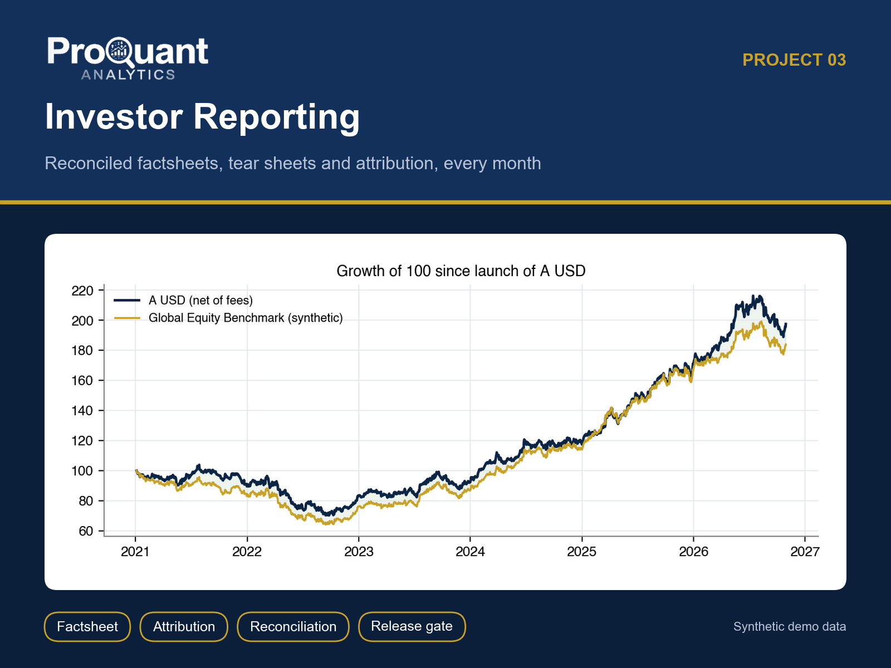
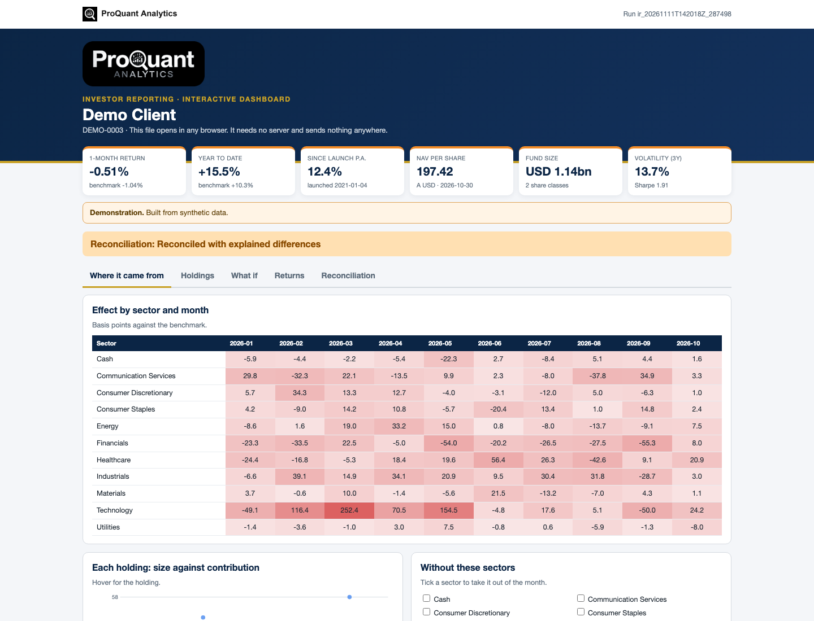
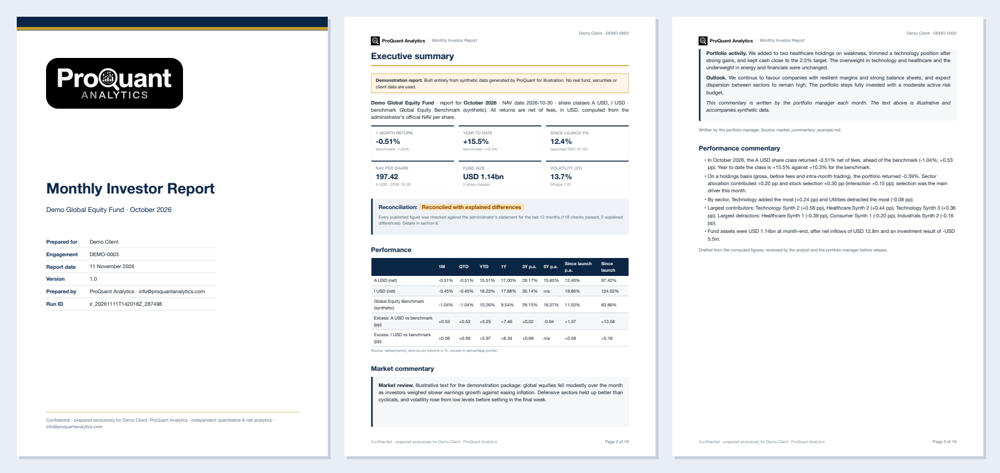
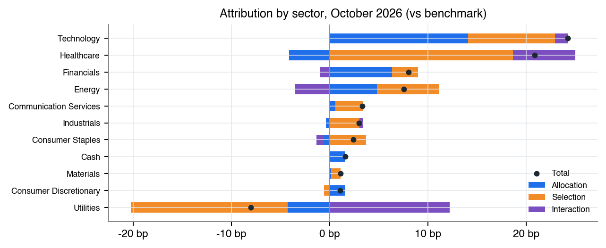
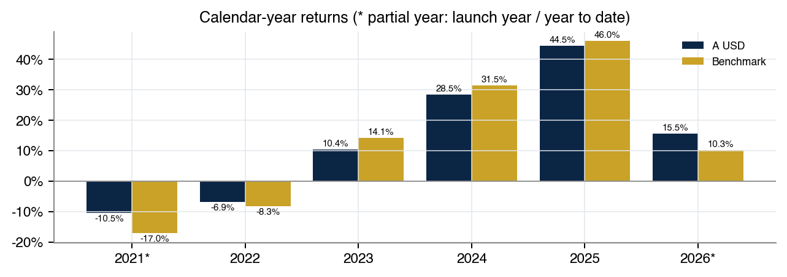
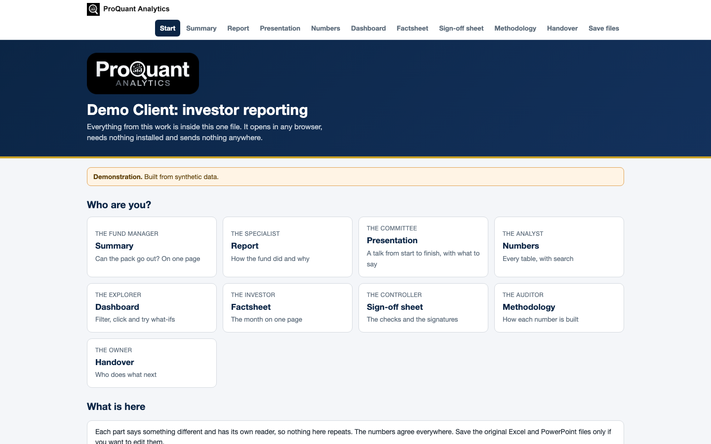

# Investor Reporting

**A reconciled monthly investor pack: factsheet, tear sheet, attribution and commentary, checked before release.**

  

> **Showcase repository.** It shows the method and the actual files a client receives, built on **synthetic demo data** (a fictional *Demo Client*). The numbers below are illustrative, not client results. The production code is proprietary and is not published here.

## Contents

- [Business problem](#business-problem)
- [Approach](#approach)
- [Results (demo)](#results-demo)
- [Deliverables](#deliverables)
- [Gallery](#gallery)
- [Tech stack](#tech-stack)
- [How to view it](#how-to-view-it)
- [How an engagement works](#how-an-engagement-works)

## Business problem

Monthly investor reporting is usually assembled by hand: NAVs copied from the administrator, returns recalculated in spreadsheets, charts pasted into a factsheet. Errors reach investors, and nobody can say why the fund beat or lagged its benchmark.

**Typical clients:** Emerging and mid-sized fund managers, family offices, fund platforms, ManCos and fund administrators.

## Approach

- Net-of-fee, time-weighted returns per share class: 1M, QTD, YTD, 1Y, 3Y, 5Y and since launch
- Risk statistics: volatility, Sharpe, Sortino, drawdown, beta, tracking error, capture ratios
- Holdings-based Brinson-Fachler attribution by sector, linked over the year (Carino)
- AUM bridge, capital activity, top holdings and active weights
- Reconciliation against the administrator (NAV, returns, shares) with a release gate
- One-page factsheet, investor web page and a manager-ready presentation

## Results (demo)

**Overall opinion on the demo data:** Reconciliation: Reconciled with explained differences

| Measure | Value | Context |
|---|---:|---|
| 1-month return | **-0.51%** | benchmark -1.04% |
| Year to date | **+15.5%** | benchmark +10.3% |
| Since launch p.a. | **12.4%** | launched 2021-01-04 |
| NAV per share | **197.42** | A USD · 2026-10-30 |
| Fund size | **USD 1.14bn** | 2 share classes |
| Volatility (3Y) | **13.7%** | Sharpe 1.91 |

<em>The interactive dashboard (one HTML file: Where it came from, Holdings, What if, Returns, Reconciliation). <a href="https://abduwars.github.io/proquant-03-investor-reporting/sample-delivery/10_DemoClient_InvestorReporting_Dashboard_v1.0_20261111.html">Open it live</a>.</em>

## Deliverables

Everything opens from **one file**, *Start here* (no. 1), in any browser: pick your role, read each document, watch the presentation, search the tables and use the dashboard. Each document has one reader and one job, and the numbers agree across all of them. PowerPoint and Excel files open in the browser through Microsoft's free online viewer; *download* gives the original file.

| # | File | Format | What it is |
|---|---|---|---|
| 1 | [Start here](https://abduwars.github.io/proquant-03-investor-reporting/sample-delivery/00_START_HERE_DemoClient.html) | HTML (opens in any browser) | **One file that holds it all**: every document, the presentation, the tables and the dashboard |
| 2 | [Report](sample-delivery/01_DemoClient_InvestorReporting_Report_v1.0_20261111.pdf) | PDF | Monthly investor report (~19 pages) |
| 3 | [Investor Tear Sheet](sample-delivery/02_DemoClient_InvestorReporting_InvestorTearSheet_v1.0_20261111.pdf) | PDF | **Factsheet for investors**: the month on one page |
| 4 | [Presentation](https://view.officeapps.live.com/op/view.aspx?src=https%3A%2F%2Fabduwars.github.io%2Fproquant-03-investor-reporting%2Fsample-delivery%2F03_DemoClient_InvestorReporting_Presentation_v1.0_20261111.pptx) | PowerPoint · [download](https://raw.githubusercontent.com/AbduWars/proquant-03-investor-reporting/main/sample-delivery/03_DemoClient_InvestorReporting_Presentation_v1.0_20261111.pptx) | **A full talk**: 13 slides with editable charts and speaker notes, ready to present |
| 5 | [Results Workbook](https://view.officeapps.live.com/op/view.aspx?src=https%3A%2F%2Fabduwars.github.io%2Fproquant-03-investor-reporting%2Fsample-delivery%2F04_DemoClient_InvestorReporting_ResultsWorkbook_v1.0_20261111.xlsx) | Excel · [download](https://raw.githubusercontent.com/AbduWars/proquant-03-investor-reporting/main/sample-delivery/04_DemoClient_InvestorReporting_ResultsWorkbook_v1.0_20261111.xlsx) | **The working file**: a Control panel with live formulas, and every table. Opens on a **Read me** sheet with a linked index |
| 6 | [Methodology](sample-delivery/05_DemoClient_InvestorReporting_Methodology_v1.0_20261111.pdf) | PDF | How every figure is calculated (for auditors, consultants, due diligence) |
| 7 | [Handover Note](sample-delivery/06_DemoClient_InvestorReporting_HandoverNote_v1.0_20261111.pdf) | PDF | What was delivered, headline result, assumptions, monthly process |
| 8 | [Release Summary](sample-delivery/07_DemoClient_InvestorReporting_ReleaseSummary_v1.0_20261111.pdf) | PDF | **One page for the fund manager**: can the pack go out, with no charts |
| 9 | [Reconciliation Sign Off](sample-delivery/08_DemoClient_InvestorReporting_ReconciliationSignOff_v1.0_20261111.pdf) | PDF | **Reconciliation and sign-off sheet**: every check, the release decision, signature blocks |
| 10 | [Investor Web Page](https://abduwars.github.io/proquant-03-investor-reporting/sample-delivery/09_DemoClient_InvestorReporting_InvestorWebPage_v1.0_20261111.html) | HTML (opens in any browser) | **Investor web page**: one self-contained file, works offline and on phones, ready for an investor portal |
| 11 | [Dashboard](https://abduwars.github.io/proquant-03-investor-reporting/sample-delivery/10_DemoClient_InvestorReporting_Dashboard_v1.0_20261111.html) | HTML (opens in any browser) | **Interactive dashboard in one file**: opens in any browser, explores the data, tries what-ifs and reads the updated tracker |

Also delivered: data-quality reports and long-format CSV / Parquet exports for Power BI or Looker Studio.

<em>The first pages of the PDF report.</em>

## Gallery

<table><tr>
<td width="50%"></td>
<td width="50%"></td>
</tr></table>

<em>The start page: one file, one click, nothing to install.</em>

## Tech stack

Python · pandas · NumPy · matplotlib · Jinja2 + WeasyPrint (PDF) · openpyxl (Excel) · python-pptx (PowerPoint) · pydantic · pytest

Every run is reproducible and audited: data fingerprints, configuration and code version are recorded, data-quality checks run before any calculation, and an automated test suite checks every deliverable (including opening the decks and workbooks in Microsoft Office).

## How to view it

1. **In the browser (nothing to install):** open the [live start page](https://abduwars.github.io/proquant-03-investor-reporting/sample-delivery/00_START_HERE_DemoClient.html) or the [dashboard](https://abduwars.github.io/proquant-03-investor-reporting/sample-delivery/10_DemoClient_InvestorReporting_Dashboard_v1.0_20261111.html).
2. **Download:** click any PDF, Excel or PowerPoint file in the table above, or clone the repository: `git clone https://github.com/AbduWars/proquant-03-investor-reporting.git`.
3. **On your own data:** this is delivered as a fixed-scope engagement. Write to [info@proquantanalytics.com](mailto:info@proquantanalytics.com).

## How an engagement works

| Step | What happens |
|---|---|
| 1. Discovery call | Your question, your data and the decision the work must support |
| 2. Scope and NDA | Fixed scope, timeline and thresholds agreed **before** any result is seen |
| 3. Data request | A precise list of files or read-only access; personal data pseudonymised |
| 4. Build and interim update | First results, open questions and data issues, early |
| 5. Delivery | The full package above, on your data, with a walk-through |
| 6. Handover | Methodology, runbook where relevant, and optional monthly refresh |

---

<b>ProQuant Analytics</b> · Quant & risk analytics, business analytics, data engineering and AI automation Rotterdam, NL · remote-first <a href="https://www.proquant-analytics.com">www.proquant-analytics.com</a> · <a href="mailto:info@proquantanalytics.com">info@proquantanalytics.com</a> · <a href="https://github.com/AbduWars">All 13 projects</a>

© 2026 ProQuant Analytics. Sample outputs on synthetic data, shown for demonstration. All rights reserved.

